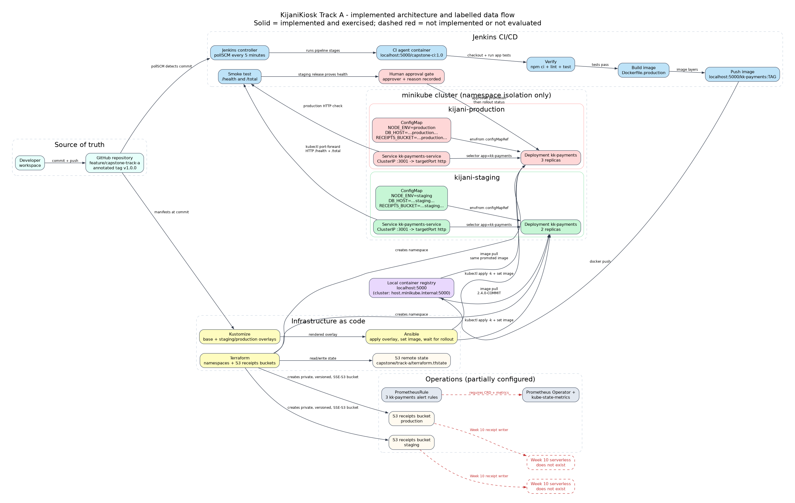

# KijaniKiosk DevOps Foundation - Track A Capstone

**Author:** Dalton Wambui  
**Track:** A - Infrastructure-first  
**Release:** `v1.0.0`  
**Working branch:** `feature/capstone-track-a`

KijaniKiosk is a payments service for a kiosk platform. This repository connects the Week 3-8 work into one staging-to-production release path: Terraform creates the environments, Kustomize and Ansible deploy one workload, Jenkins builds the image once, smoke tests prove the release, and a human approval gate controls production promotion.

## Architecture



The source is `docs/architecture.dot`; the exported image is `docs/architecture.png`. Solid arrows are implemented and exercised. Dashed red arrows are explicitly unimplemented or unevaluated.

| Layer | Choice | Responsibility |
|---|---|---|
| Infrastructure | Terraform | Creates the staging/production namespaces and separate private, versioned, encrypted receipts buckets; stores state in S3. |
| Configuration | Kustomize | Keeps one base Deployment/Service and renders environment-specific ConfigMaps, replicas, namespaces, and labels. |
| Deployment | Ansible | Applies the selected overlay, sets the exact image tag, and waits for the rollout. |
| Delivery | Jenkins | Verifies the app, builds and pushes one image, deploys staging, smoke tests, gates production, promotes the same image, and archives evidence. |
| Runtime | Kubernetes (minikube) | Runs the non-root containers with probes, resource limits, and a ClusterIP Service. |
| Operations | PrometheusRule | Defines alert rules for unavailable replicas, restarts, and missing Service endpoints. |

## Repository structure

```text
.
├── capstone/                 # Track A implementation
│   ├── ansible/              # staging.yml, production.yml, inventory
│   ├── ci/                   # Jenkins agent image
│   ├── docs/                 # requirement matrix, ownership map, oral drill, answer sheet
│   ├── evidence/             # archived Jenkins and demo evidence
│   ├── k8s/                  # base Deployment/Service, staging and production overlays
│   ├── monitoring/           # PrometheusRule
│   ├── scripts/              # smoke test, pull-secret helper, verify script
│   ├── terraform/            # namespaces, receipts buckets, S3 backend
│   └── Jenkinsfile           # capstone Jenkins pipeline
├── docs/                     # submission deliverables: scope, diagram, governance, slides, reflection
├── week3/ ... week8/         # weekly foundation work
├── starter-kit/              # Week 2 foundations
├── notes/                    # revision notes
└── Jenkinsfile               # Week 5 CI pipeline (separate from the capstone job)
```

## Prerequisites

- Linux with Docker, `kubectl`, `minikube`, Terraform, Ansible, `jq`, and Node.js.
- A running minikube cluster with the local registry reachable as `host.minikube.internal:5000`.
- Jenkins at `http://localhost:8080` with the `kijanikiosk-capstone` pipeline job.
- AWS credentials with permission to manage the namespaces, S3 buckets, and state bucket described in `capstone/terraform/`.
- The CI agent image `localhost:5000/capstone-ci:1.0`.

## Setup

```bash
git clone https://github.com/mwekundujohn-ship-it/kijaniosk-devops-foundation.git
cd kijaniosk-devops-foundation
git switch feature/capstone-track-a

terraform -chdir=capstone/terraform init
terraform -chdir=capstone/terraform apply

kubectl get ns kijani-staging kijani-production
```

The Terraform state backend is configured in `capstone/terraform/backend.tf`; do not commit credentials or state files. The receipts buckets are lab resources with `force_destroy = true`.

## Deploy

Manual staging deployment:

```bash
ansible-playbook -i capstone/ansible/inventory.ini capstone/ansible/staging.yml
capstone/scripts/smoke-test.sh kijani-staging <tag>
```

Manual production promotion:

```bash
ansible-playbook -i capstone/ansible/inventory.ini capstone/ansible/production.yml
capstone/scripts/smoke-test.sh kijani-production <tag>
```

The normal path is the Jenkins job, not manual Ansible. The capstone Jenkinsfile builds the Week 8 production image from `week8/friday/Dockerfile.production`, pushes it to `localhost:5000/kk-payments:<version>-<sha>`, and promotes that exact tag.

## CI/CD

The capstone job is `http://localhost:8080/job/kijanikiosk-capstone` and uses `capstone/Jenkinsfile`.

```text
commit -> pollSCM -> Verify (npm ci, lint, test)
       -> Build image -> Push to local registry
       -> Deploy staging -> set image -> rollout status
       -> Smoke test staging (assert expected version + total=42)
       -> Human approval (records approver + reason)
       -> Deploy production -> set image -> rollout status
       -> Smoke test production
       -> Archive evidence
```

The same image tag must appear in both namespaces. The approval record is written to `capstone/evidence/approval.txt` and archived with the build. The pipeline is designed to fail before production if staging is unhealthy or the version assertion fails.

## Configuration

| Key | Staging | Production | Consumed by |
|---|---|---|---|
| `NODE_ENV` | `staging` | `production` | Runtime configuration |
| `PORT` | `3001` | `3001` | `week8/friday/src/index.ts` |
| `DB_HOST` | `kk-payments-db.kijani-staging.svc.cluster.local` | `kk-payments-db.kijani-production.svc.cluster.local` | Reserved for the database integration; not queried by the current service |
| `RECEIPTS_BUCKET` | staging bucket | production bucket | Reserved for the Week 10 receipt chain; not consumed yet |
| `LOG_LEVEL` | `debug` | `info` | Intended logging level; the current service does not read it |

`APP_VERSION` is deliberately **not** in a ConfigMap. It is build metadata passed as a Docker build argument and baked into the image, so the version cannot drift from the artifact being promoted.

## Verification

```bash
capstone/scripts/verify.sh
```

This checks Terraform formatting/validation, both Kustomize renders, the monitoring YAML, shell syntax, and Ansible syntax.

Live checks:

```bash
kubectl -n kijani-staging get deploy,pods,svc
kubectl -n kijani-production get deploy,pods,svc
capstone/scripts/smoke-test.sh kijani-staging <tag>
capstone/scripts/smoke-test.sh kijani-production <tag>
```

Jenkins build #4 is archived in `capstone/evidence/jenkins-build-4/`. It shows the staging deployment, staging smoke test, approval gate with a recorded reason, production deployment, production smoke test, and both Deployments running the same image `2.4.0-ec8568e`. The approval record is `capstone/evidence/jenkins-build-4/approval.txt`; the current live state and rubric traceability are in `capstone/docs/requirement-matrix.md`.

## Security

- Containers run as UID/GID `10001` with `allowPrivilegeEscalation: false`, a read-only root filesystem, and all capabilities dropped.
- The registry pull secret is created at runtime by `capstone/scripts/create-pull-secret.sh`; credentials are never committed.
- S3 receipts buckets block public access, enable versioning, and use SSE-S3.
- The repository must not contain cloud keys, registry passwords, or GitHub tokens. The local `.git/config` still contains a plaintext GitHub token that must be rotated and replaced with SSH or a credential helper outside this submission.
- Terraform state is remote and encrypted; state files are not committed.

## Limitations and production gaps

- Production is a namespace in the same minikube cluster, not a separate cluster or AWS account. Namespace isolation is demonstrated; failure isolation is not.
- The Week 10 serverless receipt chain is not implemented. The buckets and `RECEIPTS_BUCKET` key are prepared, but no serverless producer or consumer exists in this repository.
- The PrometheusRule is syntactically validated but not evaluated: the cluster does not run the Prometheus Operator or kube-state-metrics.
- `DB_HOST` is present and differs by environment, but no database is deployed and the service does not query it.
- The Jenkins trigger is `pollSCM` on the working branch. The capstone brief's ideal is a merge-to-main trigger; the job and branch configuration must be moved to `main` after review.
- The local registry is a single-node lab registry without retention, replication, or signing.
- The peer review and reflection must be completed by the student; AI-generated peer feedback would be fabricated evidence.

## Submission documents

- `docs/scope.pdf` - one-page scope and measurable success criteria
- `docs/architecture.png` - labelled architecture diagram
- `docs/ai-governance-log.md` - AI use, mistakes, and human corrections
- `docs/test-plan.md` - cases and evidence plan for review/demo
- `docs/slides.pdf` - 10-slide presentation deck
- `docs/reflection.pdf` - one-page reflection
- `docs/demo-script.md` - live demo sequence and fault-handling proof
- `capstone/docs/wednesday-answer-sheet.md` - oral defense cheat sheet
- `capstone/docs/requirement-matrix.md` - rubric traceability and verified/unverified status
